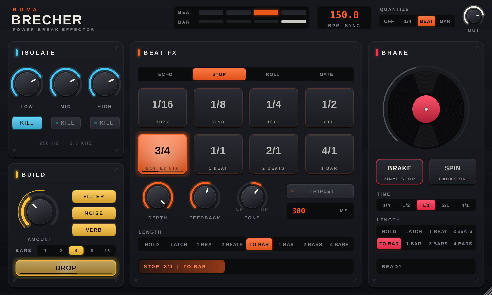

# NOVA BRECHER – Power Break Effector



Tempo-synchroner Remix-Effekt für Hard Techno und Schranz: Delay Stops, Rolls, Gates, Build-ups,
Vinyl-Brake und Backspin, alles auf den Beat quantisiert und mit einem Klick auslösbar.

Formate: **VST3 + AU** (macOS, Apple Silicon + Intel) und **VST3** (Windows).

---

## Bauen

### Weg A: GitHub baut alles automatisch (Mac + Windows, kein Xcode nötig)

1. Auf github.com ein neues Repository anlegen (privat geht).
2. Den kompletten Ordner hochladen, **inklusive des versteckten Ordners `.github`**
   (im Finder versteckte Dateien mit `Cmd + Shift + .` einblenden, oder GitHub Desktop benutzen).
3. Im Repo auf **Actions** gehen. Der Build startet von selbst und dauert ca. 10 Minuten.
4. Im fertigen Lauf unten unter *Artifacts* herunterladen:
   - `NOVA-BRECHER-macOS` → VST3 + AU, siehe `INSTALL_MAC.txt`
   - `NOVA-BRECHER-Windows` → VST3 für deine Freunde, siehe `INSTALL_WINDOWS.txt`

Bei privaten Repos zählen macOS-Builds stärker gegen die Gratis-Minuten von GitHub, für ein paar Builds im Monat reicht das locker.

### Weg B: Direkt auf deinem Mac

Voraussetzungen: Xcode Command Line Tools und CMake (das Script hilft bei beidem).

```bash
bash build_mac.sh
```

Das Script baut VST3 und AU und kopiert sie direkt nach `~/Library/Audio/Plug-Ins/`.
Der erste Build lädt JUCE herunter und dauert ein paar Minuten.

### Windows lokal

Visual Studio 2022 (C++-Workload) und CMake installieren, dann `build_windows.bat` starten.

---

## Bedienung

### Oben: Taktanzeige, Tempo, Quantize

- **BEAT / BAR**: aktueller Schlag im Takt und Takt in der 4-Takt-Phrase.
- **BPM SYNC**: Tempo kommt aus Ableton. Steht der Transport, läuft eine interne Uhr im selben Tempo weiter (`BPM FREE`).
- **QUANTIZE**: worauf Effekte einrasten. `BEAT` (Standard), `BAR`, `1/4` (Sechzehntel) oder `OFF`.
  Wer minimal zu spät drückt (bis 1/16 Beat), rastet trotzdem noch auf den gerade vergangenen Schlag ein.

### ISOLATE

3-Band-Isolator (Weichen bei 250 Hz und 2,5 kHz). Regler von −∞ bis +6 dB, **KILL** schaltet ein Band komplett weg.
Steht alles auf 0 dB, ist der Isolator komplett aus dem Signalweg, das Plugin färbt dann nichts.

### BEAT FX

| Typ | Was passiert |
|---|---|
| **ECHO** | Track läuft weiter, Echo im gewählten Beatwert darüber |
| **STOP** | Der Delay Stop: Track bricht auf dem Raster ab, das letzte Stück (z. B. 3/4 Beat) wiederholt sich mit Feedback |
| **ROLL** | Beat-Repeat, Wert lässt sich während des Rolls wechseln (1/4 → 1/8 → 1/16 …) |
| **GATE** | Rhythmisches Zerhacken |

**Pads** (Beatwerte wie beim DJ-Mixer, `1/1` = ein Schlag = 4/4, `4/1` = ein Takt):
`1/16  1/8  1/4  1/2  3/4  1/1  2/1  4/1`. **TRIPLET** macht aus allen Werten Triolen.
Die Anzeige rechts zeigt den Beatwert in Millisekunden.

- **DEPTH**: Effektstärke (bei GATE: wie tief zerhackt wird)
- **FEEDBACK**: wie lange ECHO/STOP nachhallen (ganz rechts fast endlos = Freeze)
- **TONE**: Filter auf den Wiederholungen. Rechts = dünner (Hochpass), links = dumpfer (Tiefpass)

**LENGTH** legt fest, wie ein Pad reagiert:

| Modus | Verhalten |
|---|---|
| HOLD | läuft solange du drückst |
| LATCH | an/aus per Klick |
| 1 BEAT / 2 BEATS / 1 BAR / 2 BARS / 4 BARS | ein Klick = fester Break dieser Länge |
| **TO BAR** | ein Klick = Break bis zur nächsten Eins |

Während eines festen Breaks wechselt ein anderes Pad nur den Beatwert, dasselbe Pad nochmal stoppt den Break auf dem nächsten Raster.

### BUILD

**AMOUNT** fährt drei Dinge gleichzeitig hoch: resonanten Hochpass (**FILTER**), Rausch-Riser (**NOISE**) und Hall-Fahne (**VERB**).
**RISE** macht das automatisch: startet auf dem nächsten Takt, läuft über 1–16 Takte (**BARS**) und
fällt auf der Eins danach schlagartig auf null. Das ist der Drop. Während des Rise heißt der Button **DROP**:
nochmal drücken, und es droppt auf dem nächsten Schlag. Der dünne äußere Ring am Regler zeigt, wo der Rise gerade steht.

### BRAKE

- **BRAKE**: Vinyl-Stopp, die Platte läuft in der eingestellten **TIME** aus.
- **SPIN**: Backspin, die Platte wird zurückgerissen und läuft aus.
- **LENGTH**: wie bei Beat FX. `TO BAR` (Standard) heißt: bremsen, Stille, auf der nächsten Eins wieder voll rein.

Der Plattenteller zeigt die tatsächliche Abspielgeschwindigkeit. BRAKE sitzt am Ende der Kette und stoppt alles, auch Echos und Hall.

---

## Power-Break-Rezepte

1. **Klassischer Delay Stop**: STOP · Pad `3/4` · TO BAR · QUANTIZE BEAT. Auf Schlag 3 im letzten Takt der Phrase drücken.
2. **Roll-Build mit Drop**: RISE mit 4 BARS starten. Im letzten Takt ROLL in HOLD: `1/4` → `1/8` → `1/16` durchdrücken. Auf der Eins droppt der Rise von selbst.
3. **Bass raus, Bass rein**: KILL LOW für 4 Takte, auf der Eins wieder aus.
4. **Brake-Drop**: BRAKE · TIME `1/1` · TO BAR auf Schlag 3 drücken.
5. **Backspin ins Break**: SPIN · TIME `1/2` · TO BAR auf Schlag 4.
6. **Freeze**: STOP · Pad `1/2` · FEEDBACK ganz rechts · LATCH.

---

## In Ableton automatisieren

Alle Pads, BRAKE, SPIN und RISE sind normale Parameter (z. B. `Pad 3/4`, `Brake`, `Rise Trigger`).
In der Arrangement-Ansicht einfach Automation zeichnen:

- **HOLD**: Pad-Automation an = Effekt läuft
- **feste Längen / TO BAR / RISE**: ein kurzer Impuls (aus → an) löst einen Break aus

So landen Breaks perfekt im Arrangement, auch wenn du sie live nicht drückst.

## MIDI-Controller (VST3)

Eine MIDI-Spur anlegen, bei *MIDI To* die Audiospur mit NOVA BRECHER und das Plugin wählen, Monitor auf *In*.
Dann reagieren die Noten mit echtem Halten und Loslassen:

| Note | Funktion |
|---|---|
| C1 – G1 | Pads `1/16` bis `4/1` |
| G#1 | BRAKE |
| A1 | SPIN |
| A#1 | RISE / DROP |
| C2 / C#2 / D2 | KILL Low / Mid / High (solange gehalten) |

Alternativ jeden Parameter per Ableton-MIDI-Map belegen; Pad-Taster dafür als „momentary“ (CC 127/0) senden.

---

## Technik

- JUCE 9.0.4, C++17, CMake. JUCE wird beim ersten Build automatisch geladen.
- Keine Latenz. Alle Effekte sample-genau am Host-Raster ausgerichtet.
- Plugin-ID: Hersteller `NOVA` (Code `Nova`), Plugin-Code `Brch`.
  Falls NOVA REESE und NOVA TAKTWERK einen anderen Herstellercode haben, in `CMakeLists.txt` bei
  `PLUGIN_MANUFACTURER_CODE` denselben eintragen, dann landen alle sauber unter einem Hersteller.
- JUCE steht unter AGPLv3 bzw. kommerzieller Lizenz. Für eigene Nutzung und Freunde passt das;
  falls NOVA-Plugins mal verkauft werden, die aktuellen JUCE-Lizenzbedingungen prüfen.

Quellcode: `Source/dsp` (Audio), `Source/gui` + `PluginEditor` (Oberfläche), `Tests/` (Offline-Tests, optional mit `-DBM_BUILD_TESTS=ON`).
